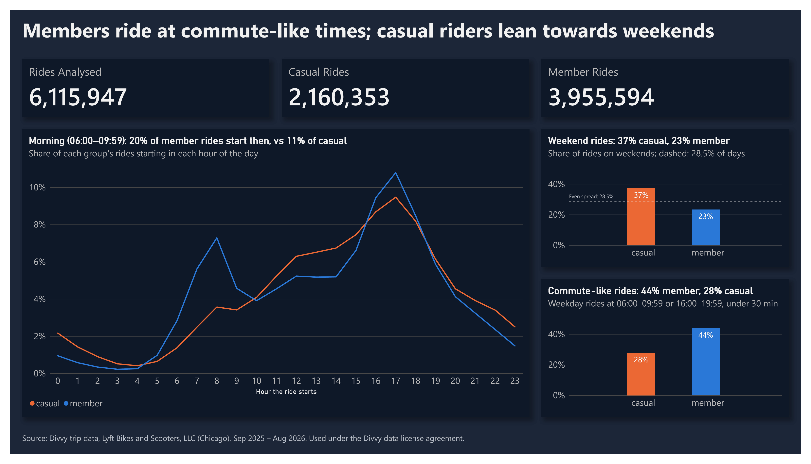
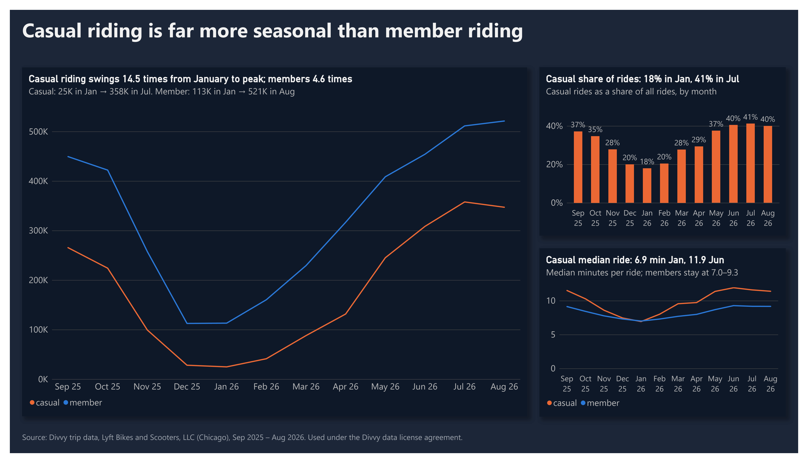
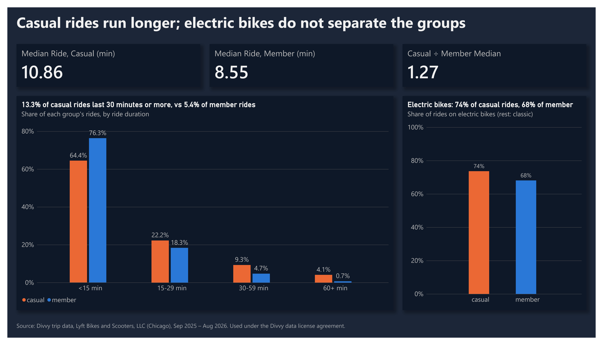
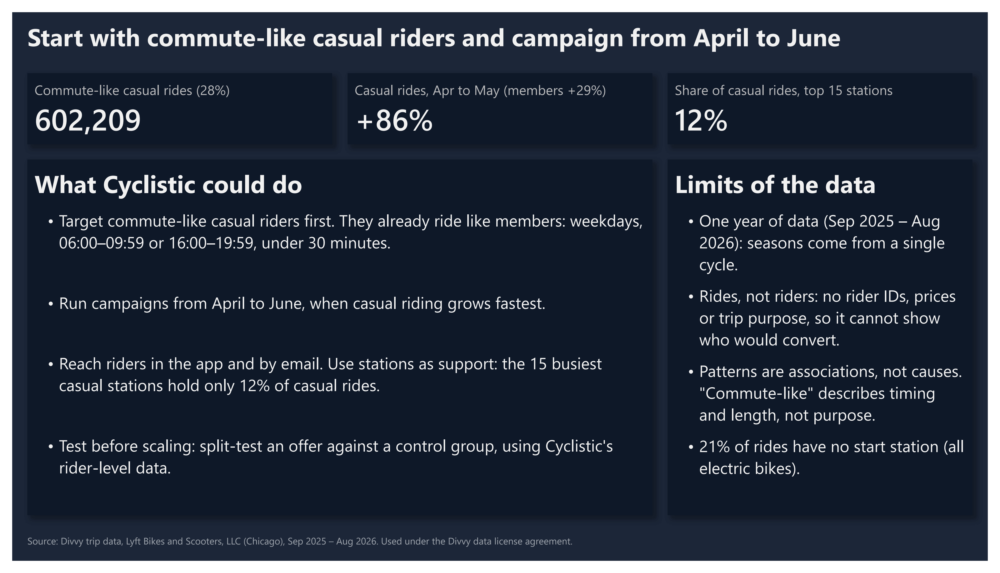

# Cyclistic Bike-Share Analysis

How do annual members and casual riders use Cyclistic bikes differently, and where could Cyclistic win more members? This project analyses 6.1 million Divvy bike-share rides (September 2025 - August 2026) with Python (pandas), SQL (PostgreSQL), Excel and Power BI.

**Dashboard:** four-page Power BI report, see [`powerbi/Cyclistic_Dashboard.pdf`](powerbi/Cyclistic_Dashboard.pdf) or the [screenshots below](#power-bi-dashboard).

## In plain terms

Cyclistic is a bike-share company. Annual members are worth more to it than people who pay per ride ("casual riders"), so it wants to turn casual riders into members. The data shows every ride: when it started and ended, the bike type, the stations and whether the rider was a member or casual. It does not show who the rider is.

The result in one paragraph: members ride mostly on weekdays with peaks in the morning and late afternoon, and they ride all year. Casual riders ride more at weekends and in summer, ride a little longer, and start more often at lakefront and tourist stations. The groups overlap, though: about 28% of casual rides look like a typical member ride (weekday, commute hours, under 30 minutes). These patterns are associated with rider type. The data cannot say why people ride, and it cannot say who would buy a membership.

## Key findings

1. **Different rhythms.** 20% of member rides start between 06:00 and 09:59, against 11% for casual rides. 37% of casual rides fall on weekends, against 23% for members.
2. **Casual riding is much more seasonal.** 47% of casual rides happen in June-August (members: 38%). In this year of data, the casual share of all rides runs from 18% in January to 41% in July.
3. **Casual rides run longer.** The median casual ride is 10.9 minutes against 8.6 for members (1.27 times). The gap in the mean is larger (20.7 against 12.4 minutes, 1.67 times) because a few very long rides pull it up; after removing rides under 1 minute and over 3 hours it is 1.46 times. 13.3% of casual rides last 30 minutes or more, against 5.4% of member rides.
4. **Casual riders start at lakefront and tourist stations, but are spread out.** They are the majority at Shedd Aquarium (82% of rides) and Navy Pier (76%), yet the ten busiest casual stations hold only about 10% of all casual rides.
5. **Bike type does not separate the groups.** The electric-bike share is 74% for casual riders and 68% for members.

## What this means for Cyclistic

1. **Start with commute-like casual riders.** About 602,000 casual rides (28% of casual rides) are weekday, commute-window rides under 30 minutes, the closest match to member behaviour. "Commute-like" describes timing and length; the data has no trip purpose.
2. **Plan campaigns for April to June.** In this year, casual rides rose 86% from April to May (members: 29%), so the pool of casual riders grows fastest in those months. One year of data cannot show whether every year looks the same.
3. **Lead with in-app and email messages; use stations as support.** The 15 busiest casual stations hold only about 12% of all casual rides.
4. **Test before scaling.** Use Cyclistic's own rider-level data to measure ride frequency and the price break-even, and split-test an offer against a control group.

Full detail and the source of every number: [`docs/findings.md`](docs/findings.md)

## Power BI dashboard

Four pages, one finding per page. Pages 1-3 answer *how the two groups differ*; page 4 turns that into recommendations and limits. Casual riders are orange, members are blue throughout.

- PDF: [`powerbi/Cyclistic_Dashboard.pdf`](powerbi/Cyclistic_Dashboard.pdf)
- Power BI file: [`powerbi/Cyclistic_Dashboard.pbix`](powerbi/Cyclistic_Dashboard.pbix) (needs Power BI Desktop; refreshing it needs the local PostgreSQL database from the steps below)
- Model and measure notes: [`powerbi/README_PowerBI_handoff.md`](powerbi/README_PowerBI_handoff.md)

**Page 1. Members ride at commute-like times; casual riders lean towards weekends**



**Page 2. Casual riding is far more seasonal than member riding**



**Page 3. Casual rides run longer; electric bikes do not separate the groups**



**Page 4. Start with commute-like casual riders and campaign from April to June**



Design choices worth knowing:

- **Medians are calculated in PostgreSQL, not in the report.** A median over 6.1 million rows in Power BI's formula language (DAX) ran out of resources, so the median views are pre-computed in SQL. The cost: the report has no slicers, because pre-computed medians would not respond to them and half-working filters are worse than none. A month slicer on pre-aggregated medians is a possible next step.
- **Stations are not in the dashboard.** Station findings are in [`docs/findings.md`](docs/findings.md) and in the Python chart `docs/images/05_top_casual_stations.png`, because 21% of rides have no start station.
- **Page 4 text and cards are typed from the SQL results**, not calculated live. Each number is traced in [`docs/findings.md`](docs/findings.md).

Charts made with Python are in [`docs/images/`](docs/images/) (files `01` to `06`).

## Limitations

- **Rides are not riders.** There are no rider IDs, so rides per person, repeat use and conversion cannot be measured.
- **No prices, revenue or trip purpose.** Membership revenue and conversion rate cannot be calculated from this dataset.
- **Station data is incomplete.** 1,285,400 rides (21% of all rides) have no start station. All of them are electric-bike rides, which is 30% of electric-bike rides.
- **One year of data.** Seasonal patterns come from a single 12-month window.
- **Descriptive analysis only.** The patterns show association, not cause.

## Data and method

- **Data:** 12 monthly Divvy trip files, September 2025 - August 2026, 13 columns, 6,115,982 raw rows.
- **Cleaning:** 35 exact duplicate rides that appear in two monthly files were removed (6,115,947 rows remain). 29 rides with a negative duration at the 2 November 2025 daylight-saving change were flagged and corrected by one hour. Rides with missing stations or end coordinates were kept and left out only of the analyses that need them. The raw files are never modified. Rules: [`docs/project_management/07_Process_Cleaning_Plan.md`](docs/project_management/07_Process_Cleaning_Plan.md).
- **Checks:** a validation step and `pytest` tests confirm the row count, no duplicate ride IDs, valid categories and no negative durations. The headline numbers were computed independently in SQL and pandas and agree exactly.
- **Method:** Ask, Prepare, Process, Analyze, Share, Act.

## Repository structure

```
Cyclistic-Bike-Share-Analysis/
├── src/cyclistic/           Pipeline: config, clean, validate, load_to_postgres, analysis, plot_charts, run_pipeline
├── tests/                   pytest tests: cleaning, validation, analysis definitions, charts, SQL reconciliation
├── sql/                     PostgreSQL scripts: schema, validation, exploration, analysis, final queries, Power BI views
├── excel/                   data_dictionary, exploratory_analysis, summary_tables
├── exploration/             One-off checks used to understand the data (scripts 00-15)
├── docs/                    findings.md, images/ (Python charts and dashboard screenshots), project_management/ (Ask, Prepare and Process notes)
├── powerbi/                 Cyclistic_Dashboard.pbix, PDF export and model notes
├── data/
│   ├── raw/                 Download instructions (data not stored here)
│   └── clean/               Output folder for cyclistic_clean.csv (not stored here)
├── pyproject.toml
└── LICENSE
```

## Run locally

Requirements: Python 3.10 or newer, and about 3 GB of free disk space.

```powershell
git clone https://github.com/aliakbarda/Cyclistic-Bike-Share-Analysis.git
cd Cyclistic-Bike-Share-Analysis
python -m venv .venv
.venv\Scripts\Activate.ps1
python -m pip install -e ".[dev]"
```

1. Download the 12 monthly files and extract them as described in [`data/raw/README.md`](data/raw/README.md).
2. Build and check the clean table and draw the charts (a few minutes): `python -m cyclistic.run_pipeline`
3. Run the tests: `python -m pytest -v`
4. Optional, load PostgreSQL and run the full-data tests. Create a database called `cyclistic`, set `PGPASSWORD`, then:
   `python -m cyclistic.load_to_postgres`
   `$env:CYCLISTIC_FULL_TESTS = "1"; python -m pytest -v`

Some scripts in `exploration/` still contain absolute Windows paths; change them to your own before running them.

## SQL layer

The scripts in `sql/` are written for PostgreSQL. `01_data_validation.sql` and `02_exploration.sql` check the data, `03_analysis.sql` holds the deeper analysis and `04_final_queries.sql` holds the queries behind the findings (KPIs, weekday-by-hour heatmap, seasons, commute-like rides, round trips and station rankings). `00_schema.sql` creates the table (with `ride_id` as the primary key and `CHECK` rules for the categories and durations), and `python -m cyclistic.load_to_postgres` fills it with `COPY` and checks the row count. A test compares the headline numbers from PostgreSQL with the pandas results.

The Power BI report reads four PostgreSQL views: `vw_fact_rides` (one row per ride) and `vw_dim_month` in `05_powerbi_views.sql`, and `vw_median_overall` and `vw_median_by_month` in `06_powerbi_median_views.sql`.

## Next steps

- Phase 2 (done): PostgreSQL schema and load script, analysis and charts as tested Python modules, SQL and pandas reconciled in a test.
- Phase 3 (done): four-page Power BI dashboard with a PDF export and screenshots.
- Possible extensions: a month slicer fed by pre-aggregated medians, and a station page once the missing-station rides are handled.

## Data licence and credit

The trip data is published by Lyft Bikes and Scooters, LLC for the Divvy bike-share system in Chicago, and is used here for a portfolio analysis project. It is subject to the Divvy data licence agreement; read it before reusing the data (see https://divvybikes.com/system-data). The raw and clean data files are not stored in this repository, and the MIT licence below does not cover them.

## Code licence

The code and documentation are released under the MIT licence; see [`LICENSE`](LICENSE).

## Author

Ali Akbar
